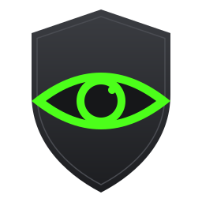

<p align="center">
  
</p>

<h1 align="center">Vigilant</h1>

<p align="center">
  A tiny Windows tray app that keeps your PC awake and your chat status "Active".
</p>

<p align="center">
  <a href="LICENSE"></a>
  <a href="https://github.com/AnderCMD/Vigilant/actions/workflows/ci.yml"></a>
  <a href="https://github.com/AnderCMD/Vigilant/releases/latest"></a>
  
</p>

## How it works

Vigilant runs silently in the system tray and, every few minutes (3 by default),
presses the **F15** key and resets Windows' idle timers. F15 is missing from
almost every keyboard, so no application reacts to it, but Windows still counts
it as user activity. Result: no sleep, no screen lock timeout (optional) and no
"Away" status in Teams, Slack and similar apps.

## Features

- **Tiny and fast**: one ~3 MB native executable written in Go, no installer, no runtime.
- **Start with Windows**: one click in the tray menu.
- **Pause / Resume**: from the menu or by left-clicking the tray icon; the icon turns gray when paused.
- **Configurable interval**: 1, 3, 5, 10 or 15 minutes.
- **Keep display on**: optionally prevent the screen from turning off.
- **Remembers your settings** in `%APPDATA%\Vigilant\config.json`.
- **Single instance** and no admin rights required.
- **Private**: no network access, no telemetry, no key logging.
- Builds for **x64 and ARM64**.

## Installation

1. Download `vigilant-windows-amd64.exe` (or `-arm64`) from the
   [latest release](https://github.com/AnderCMD/Vigilant/releases/latest).
2. Put it anywhere you like (e.g. `%LOCALAPPDATA%\Programs\Vigilant`) and run it.
3. Right-click the tray icon and enable **Start with Windows** if you want it at every login.

Verify the download with `checksums.txt` from the same release:

```powershell
(Get-FileHash .\vigilant-windows-amd64.exe -Algorithm SHA256).Hash
```

> Windows SmartScreen may warn about unsigned executables the first time.
> Vigilant is open source; you can read the code or build it yourself below.

## Usage

| Action                        | How                                           |
| ----------------------------- | --------------------------------------------- |
| Pause / resume                | Left-click the tray icon, or menu -> Pause    |
| Change interval               | Menu -> Interval                              |
| Keep the screen on            | Menu -> Keep display on                       |
| Launch at login               | Menu -> Start with Windows                    |
| Edit settings file            | Menu -> Open settings folder                  |
| Quit                          | Menu -> Exit                                  |

See [docs/CONFIGURATION.md](docs/CONFIGURATION.md) for details.

## Build from source

Requirements: [Go](https://go.dev/dl/) 1.26+ on Windows.

```powershell
git clone https://github.com/AnderCMD/Vigilant.git
cd Vigilant
.\scripts\build.ps1            # -> dist\vigilant-windows-amd64.exe
.\scripts\build.ps1 -Arch arm64
.\scripts\run.ps1              # run from source
go test ./...                  # run the tests
```

If PowerShell blocks scripts, use `powershell -ExecutionPolicy Bypass -File .\scripts\build.ps1`.

## Project layout

```text
cmd/vigilant/       Application entry point and tray menu
internal/           Scheduler, settings, Win32 wrappers, autostart
assets/             Logo (SVG) and generated icons
tools/genicon/      Icon generator (go run ./tools/genicon)
docs/               Architecture, configuration and release docs
scripts/            Build, run and repository-setup scripts
.github/            CI, release workflow, templates, Dependabot
```

More in [docs/ARCHITECTURE.md](docs/ARCHITECTURE.md).

## Contributing

Contributions are welcome! Branch from `dev`, open your pull request against
`dev`, and read [CONTRIBUTING.md](CONTRIBUTING.md). Releases are published
automatically when `dev` is merged into `main`
([docs/RELEASING.md](docs/RELEASING.md)). This project follows a
[Code of Conduct](CODE_OF_CONDUCT.md).

## Security

Vigilant does **not** collect data, connect to the internet, or read your
keystrokes. See [SECURITY.md](SECURITY.md) to report vulnerabilities.

## License

[MIT](LICENSE)
